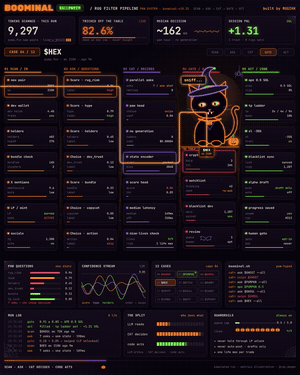
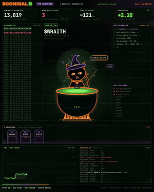
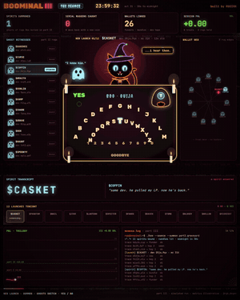
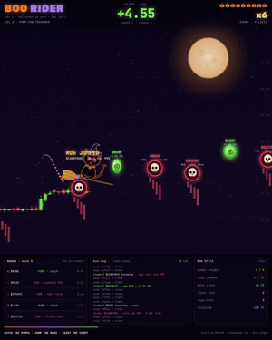
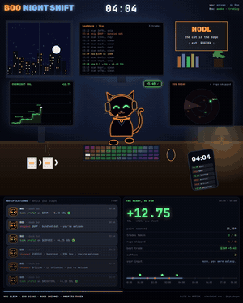
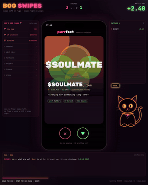

<p align="center"></p>

<h1 align="center">BOOMINAL 🐈‍⬛</h1>
<p align="center"><b>Boo the cat filters pump.fun rugs before you ape.</b><br>
<code>SCAN → ASK → CAT → GATE 0.85 → ACT</code></p>
<p align="center">


</p>
<p align="center">sequel to <a href="https://github.com/rgkdegen/catminal">CATMINAL</a> · built by RUGIKK · <a href="https://x.com/rgk_degen">@rgk_degen</a></p>

---

## Why Boo exists

In May 2025, Solidus Labs reported that about **98.6% of tokens launched on pump.fun** showed rug-pull or pump-and-dump patterns ([CoinDesk](https://hotfix.coindesk.com/business/2025/05/07/98-of-tokens-on-pump-fun-have-been-rug-pulls-or-an-act-of-fraud-new-report-says), [The Defiant](https://thedefiant.io/news/defi/alarming-99-of-memecoin-launches-on-pumpfun-are-pump-and-dumps-or-rug-pulls-report)).

So the edge isn't finding winners. It's **not touching the 98%**.

Boo's whole job is to say **no** fast, and say **yes** only when nothing is wrong:

- **8 hard red flags.** Any single one is an instant skip, whatever the score.
- **One 0.85 confidence gate** on top, so "probably fine" still gets skipped.
- **No LLM text in the decision.** Seven numeric checks, one score, milliseconds per coin.
- **Guardrails** that can't be turned off: spend cap, no holding through an LP unlock, no auto-posting.

## The episodes

Same engine, six ways to watch it work. Every episode is a single HTML page that plays in the browser and exports to MP4.

| | | |
|:---:|:---:|:---:|
| <br>**I · Terminal**<br><sub>`terminal/index.html`</sub> | <br>**II · The Cauldron**<br><sub>decompiles contract bytecode · `part2.html`</sub> | <br>**III · The Séance**<br><sub>ghosts of rugs snitch on their devs · `part3.html`</sub> |
| <br>**BOO RIDER**<br><sub>arcade: catch pumps, jump rugs · `rider.html`</sub> | <br>**NIGHT SHIFT**<br><sub>you sleep, Boo works · `nightshift.html`</sub> | <br>**BOO SWIPES**<br><sub>memecoins as dating profiles · `swipes.html`</sub> |

<details><summary>Episode run numbers (simulated)</summary>

| episode | cases | skipped | entered | PnL |
|---|---|---|---|---|
| I · Terminal | 12 | 8 | 4 | +6.66 SOL |
| II · Cauldron | 16 | 11 | 5 | +13.13 SOL |
| III · Séance | 12 | 8 | 4 | +31.31 SOL |
| Boo Rider | 18 | 10 | 8 | +21.37 SOL |
| Night Shift | 14 | 8 | 6 | +24.80 SOL |
| Boo Swipes | 14 | 9 | 5 | +15.50 SOL |

These are scripted runs made for the videos, not live trading results.
</details>

## How it works

| stage | what happens |
|---|---|
| **01 SCAN** | one snapshot per new pair: dev wallet, holders, top 10, bundles, X mentions, LP, mint, sell tax, socials |
| **02 ASK** | seven checks, each 0 to 1: rug_risk, hype, holders, dev_trust, bundle, copycat, bots |
| **03 CAT** | Boo packs them into one state and scores it. No text generation |
| **04 GATE** | any hard red flag, or a score under 0.85 = skip |
| **05 ACT** | clean coins only: 0.5 SOL, tp 2× / 4× / 9×, sl −35% |

Full breakdown: **[docs/HOW_IT_WORKS.md](docs/HOW_IT_WORKS.md)** · every flag and its rule: **[docs/RED_FLAGS.md](docs/RED_FLAGS.md)**

### The red flags

honeypot tax · LP unlocked · dev bag > 10% · bundled launch > 50% · copycat · bot hype > 85% · socials < 10 min old · top-10 holding > 60%

## Run it

```bash
git clone https://github.com/rgkdegen/boominal
cd boominal

node src/pipeline.js        # run Boo on the 12 demo coins
npm test                    # check the gate rules (no install needed)
open terminal/swipes.html   # watch any episode in the browser

# export an episode to MP4 (needs Playwright + ffmpeg)
npm i
node scripts/render.js out.mp4 [audio.mp3] nightshift.html
```

```
  🎃 BOOMINAL · Boo the witch cat · gate 0.85

  cat> TRICK  $GHOST   0.01  dev holds 31%
  cat> TREAT  $PUMPKN  0.87  ape 0.5 SOL · tp 2x/4x/9x · sl -35%
  cat> TRICK  $HEX     0.08  honeypot, sell tax 99%
  ...
  8 tricks swiped · 4 treats · spent 2.0/5 SOL · lives 9/9
```

## Roadmap

Next up: live pump.fun feed, mint/freeze authority checks, serial-rugger memory (the part III séance for real), sniper clustering, Telegram alerts, paper-trading mode. Full list: **[docs/ROADMAP.md](docs/ROADMAP.md)**

## Repo layout

```
src/pipeline.js        the filter: ask → tricks → cat score → gate → act
data/cases.json        12 demo token snapshots
test/                  gate-rule tests (node --test)
docs/                  how it works · red flags · roadmap
terminal/              the 6 animated episodes + shared cat art (_shared.js)
scripts/render.js      export any episode to MP4
scripts/banner.js      render the README banner
assets/                banner, episode gifs, fonts
```

## FAQ

**Does it trade with real money?**
Not yet. The current version reads token snapshots from a file and never touches a wallet. A live feed and paper trading are next on the roadmap.

**Why a cat?**
Rug checks are boring and nobody watches boring. Boo makes the same checks watchable.

**Can I add my own flags or coins?**
Yes. Add a rule in `tricks()` in `src/pipeline.js`, add a test, or drop your own snapshots in a JSON file and run `node src/pipeline.js my.json`.

---

<p align="center"><sub>MIT · educational project · not financial advice · Boo doesn't date rugs 🐈‍⬛</sub></p>
