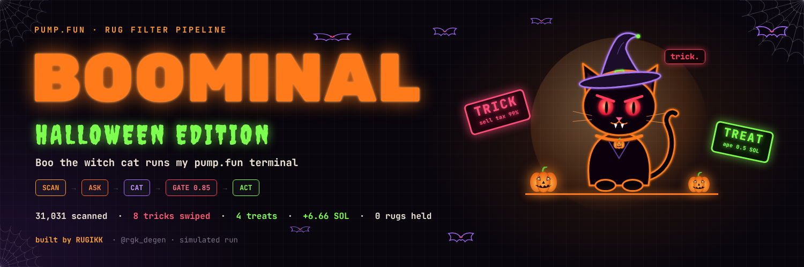
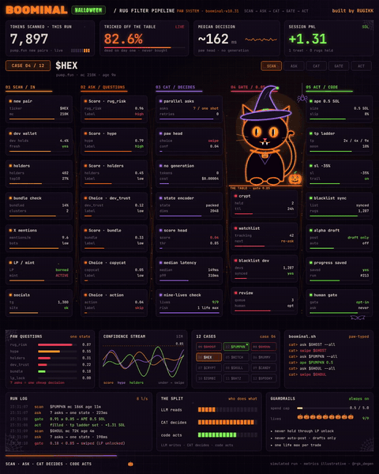
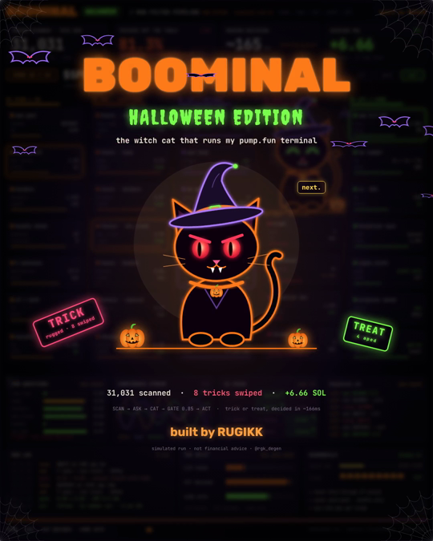

<p align="center"></p>

<h1 align="center">BOOMINAL 🎃</h1>
<p align="center"><b>Boo the witch cat runs my pump.fun terminal.</b><br>
<code>SCAN → ASK → CAT → GATE 0.85 → ACT</code></p>
<p align="center">Halloween edition of <a href="https://github.com/rgkdegen/catminal">CATMINAL</a> · built by RUGIKK · <a href="https://x.com/rgk_degen">@rgk_degen</a></p>

---

## What it is

BOOMINAL is a rug-filter pipeline for fresh pump.fun pairs, run by **Boo**, a black witch cat with fangs and nine lives.

Every new coin gets one question: **trick or treat?**

- **Trick:** the score is under 0.85 or the coin trips a hard rug flag. Boo swipes it off the table and never buys.
- **Treat:** the score clears the gate. The code apes 0.5 SOL and sets a take-profit ladder.

The LLM reads, Boo decides, the code acts. No text generation happens in the decision path, so a call takes about 166 ms.

<p align="center"></p>

## Halloween night run

| | |
|---|---|
| Pairs scanned | **31,031** |
| Tricked off the table | **81.3%** dead on day one, never bought |
| Cases on the table | 12 |
| Tricks swiped | **8** |
| Treats aped | **4** ($PUMPKN, $WITCH, $CANDY, $SPOOKY) |
| Session PnL | **+6.66 SOL** |
| Rugs held | **0** |
| Median decision | ~166 ms |

### What Boo swiped

| Ticker | Trick |
|---|---|
| $GHOST | dev holds 31% |
| $GHOUL | LP unlocked |
| $HEX | honeypot, 99% sell tax |
| $MUMMY | 71% bundled |
| $CRYPT | copycat of $WITCH |
| $SKULL | 92% of X mentions are bots |
| $ZOMBI | socials 3 minutes old |
| $BATZ | top 10 wallets hold 64% |

## The pipeline

| Stage | What happens |
|---|---|
| **01 SCAN** | new pair, dev wallet, holders, top 10, bundle check, X mentions, LP / mint, socials |
| **02 ASK** | seven cheap questions (rug_risk, hype, holders, dev_trust, bundle, copycat, bots), each a number in 0–1 |
| **03 CAT** | Boo packs the answers into one state and scores it with paw head and score head. No generation, ~$0.00004 per call |
| **04 GATE** | under 0.85 is a trick and goes to the crypt, watchlist, dev blacklist or human review |
| **05 ACT** | 0.85 or higher is a treat: ape 0.5 SOL, tp ladder 2× / 4× / 9×, sl −35%, blacklist sync, alpha post saved as a draft |

### Guardrails (always on)

- never holds through an LP unlock
- 5 SOL spend cap per session
- one life max per trade (Boo has 9)
- never auto-posts; drafts only

## Run it

```bash
git clone https://github.com/rgkdegen/boominal
cd boominal

# 1. the pipeline demo on the Halloween cases
node src/pipeline.js

# 2. the animated terminal: just open it in a browser
open terminal/index.html

# 3. export the 30s clip and the banner (needs Playwright + ffmpeg)
npm i
npm run render      # → boominal.mp4 (1080×1350, 30 fps)
npm run banner      # → assets/banner.png
```

Sample output:

```
  🎃 BOOMINAL · Boo the witch cat · gate 0.85

  cat> TRICK  $GHOST   0.01  dev holds 31%
  cat> TREAT  $PUMPKN  0.87  ape 0.5 SOL · tp 2x/4x/9x · sl -35%
  cat> TRICK  $HEX     0.08  honeypot, sell tax 99%
  cat> TREAT  $WITCH   0.95  ape 0.5 SOL · tp 2x/4x/9x · sl -35%
  ...
  8 tricks swiped · 4 treats · spent 2.0/5 SOL · lives 9/9
```

## The saga

| File | Episode | Run |
|---|---|---|
| `terminal/index.html` | **I · Halloween Edition**: SCAN → ASK → CAT → GATE → ACT | +6.66 SOL |
| `terminal/part2.html` | **II · The Cauldron**: Boo decompiles contract bytecode, buries 11 rugs | +13.13 SOL |
| `terminal/part3.html` | **III · The Séance**: ghosts of buried rugs snitch on their devs' new launches | +31.31 SOL |
| `terminal/rider.html` | **BOO RIDER**: arcade run, catch pumps, jump rugs, paint the chart | +21.37 SOL |
| `terminal/nightshift.html` | **NIGHT SHIFT**: you sleep 00:00 → 08:00, Boo trades at the desk | +24.80 SOL |

Export any episode: `node scripts/render.js out.mp4 [audio] part2.html`

## Repo layout

```
terminal/index.html   animated BOOMINAL terminal (plays live in the browser)
src/pipeline.js       SCAN → ASK → CAT → GATE → ACT scoring logic
data/cases.json       the 12 Halloween-night token snapshots
scripts/render.js     export the terminal to MP4
scripts/banner.js     render the README banner
assets/               banner, preview gif, fonts
```

---

<p align="center"></p>

<p align="center"><sub>Simulated run. Metrics are illustrative. Not financial advice. Trick or treat 👻</sub></p>
